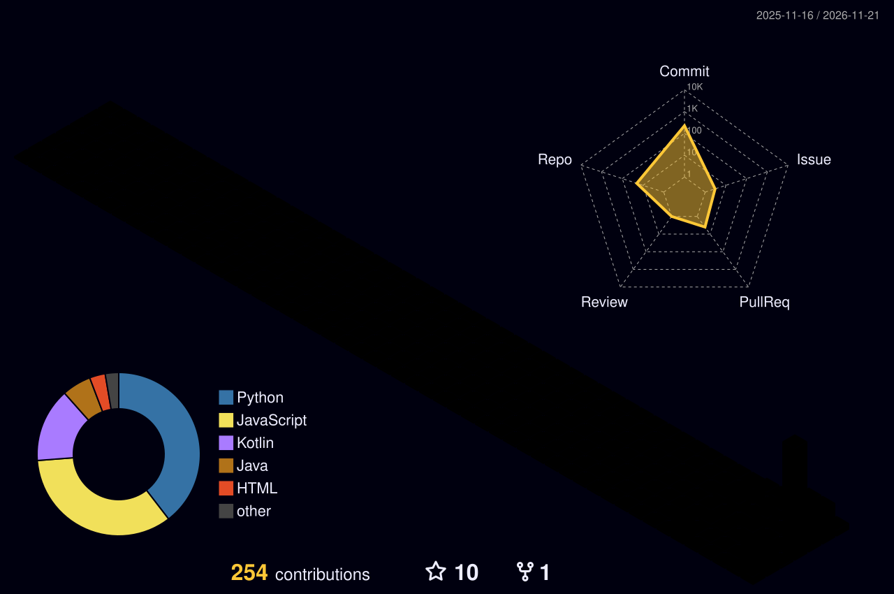

<!-- ═══════════════════════════════════════════════════════════════════
     FlyPhantomFly · GitHub profile README

     Everything here is GitHub-safe: no JS, no CSS (GitHub strips both).
     All motion comes from SMIL-animated SVGs + Actions-generated assets:

       1. capsule-render header / footer  → fadeIn + blinking text
       2. readme-typing-svg tagline       → endless typing loop
       3. streak-stats card               → animated ring & fire
       4. contribution snake              → SMIL path animation, built by
          the "generate contribution snake" workflow → `output` branch
       5. 3D contribution wall            → built by
          "GitHub-Profile-3D-Contrib" → committed to ./profile-3d-contrib/

     The snake & the 3D wall appear after their first workflow run
     (Actions tab → Run workflow). See SETUP.md for deployment.

     Palette: dark #0D1117 · neon green #00FF9F · vercel blue #0070F3
     ═══════════════════════════════════════════════════════════════════ -->

<div align="center">

<a href="https://github.com/FlyPhantomFly">
  
</a>

<br/>

<a href="https://git.io/typing-svg">
  
</a>

<br/>
<br/>

<a href="https://github.com/FlyPhantomFly?tab=followers"></a>
<a href="https://github.com/PhantomThreads"></a>


</div>

<br/>

## `$ whoami`

```bash
phantom@parrot:~$ whoami
FlyPhantomFly — the phantom you see. @PhantomThreads is the one you don't.

phantom@parrot:~$ cat ~/profile.md
I live where Android internals meet Linux userland and LLM research.
Some days I'm flashing ROMs or reading smali until the sources confess.
Some days I'm haunting a Parrot terminal, asking language models
questions they didn't want to answer. The rest of the time,
something gets disassembled — carefully, and mostly legally.

phantom@parrot:~$ ps aux | grep -i passion
USER              COMMAND
android           roms --kernels --kernelsu --adb-surgery --smali
parrot-linux      mate-desktop --pentest-toolbox --daily-driver
llm-research      finetune --evals --local-inference --token-archaeology
reverse-eng       apk --elf --firmware --everything-is-reversible

phantom@parrot:~$ history | tail -4
  101  adb shell su -c "curiosity > warranty"
  102  parrot-upgrade && echo "still flying"
  103  python finetune.py --model small --tokens many
  104  r2 -A target.bin   # read the disassembly, not the docs

phantom@parrot:~$ logout
Connection to github closed by phantom. [process exited 0]
```

<br/>

---

## Android — from ROMs to root

> My pocket computer behaves exactly how I say — because I told it to.

- **ROMs & kernels** — flashing, patching, and the occasional 2 AM rescue mission
- **Root done right** — KernelSU modules, LSPosed hooks, root that lives in the kernel — not userspace
- **Deep in the stack** — ADB surgery, NDK/JNI, and smali archaeology when sources lie
- **Hardened, not babysat** — my phone distrusts more apps than I do

<p align="center">
  <a href="https://skillicons.dev">
    
  </a>
</p>

<p align="center">
  
  
  
  
  
</p>

---

## Parrot Linux — daily driver, not a VM

> Full-time Parrot Security OS. The toolbox is home, and home is a toolbox.

- **Runs on metal** — not a VM, not a screenshot; a tuned, encrypted daily driver
- **Pentest utilities, reused for peace** — the same tools that probe networks also fix them
- **Debian underneath, terminal on top** — bash/zsh/tmux wired to muscle memory
- **Reproducible nest** — scripts that can rebuild the whole roost from a bare ISO

<p align="center">
  <a href="https://skillicons.dev">
    
  </a>
</p>

<p align="center">
  
  
</p>

---

## AI / LLM Research — tokens are the new bytecode

> Small models that punch above their weight, and questions models don't want to answer.

- **Fine-tuning** — quantized open models tuned on humble hardware
- **Evals over vibes** — harnesses that measure what a model *does*, not what its README claims
- **Adversarial curiosity** — prompt injection, jailbreak taxonomies, defense-in-depth prompting
- **Local-first inference** — Ollama, llama.cpp; the phantom runs at home

<p align="center">
  <a href="https://skillicons.dev">
    
  </a>
</p>

<p align="center">
  
  
  
  
  
</p>

---

## Reverse Engineering — everything is reversible

> APKs, ELFs, firmware. Everything confesses eventually.

- **Mobile** — jadx + Ghidra + Frida; from Play Store to smali to *"oh, that's how it works"*
- **Binaries** — radare2 / Ghidra / x64dbg against ELF, PE and stubborn packers
- **Firmware & memory** — binwalk dumps, Volatility timelines, UART confessions
- **Traffic** — Wireshark + Burp; the network never lies (for long)

<p align="center">
  
  
  
  
  
  
  
  
  
  
  
  
  
</p>

<p align="center">
  <sub>Interoperability, security research, and making software behave.</sub>
</p>

---

## The phantom, quantified

<div align="center">
  <a href="https://github.com/FlyPhantomFly">
    
  </a>
  <a href="https://github.com/FlyPhantomFly?tab=repositories">
    
  </a>
</div>

<div align="center">
  <a href="https://git.io/streak-stats">
    
  </a>
</div>

<details>
<summary><b>PhantomThreads — the other shadow</b></summary>
<br/>
<div align="center">
  <a href="https://git.io/streak-stats">
    
  </a>
</div>

<div align="center">
  <a href="https://github.com/PhantomThreads?tab=repositories">
    
  </a>
</div>

<p align="center">
  <sub>the shadow is young — these cards fill in as it moves</sub>
</p>
</details>

<br/>

<div align="center">
  
</div>

<br/>

<div align="center">
  
</div>

<br/>

<div align="center">
  <picture>
    <source media="(prefers-color-scheme: dark)" srcset="https://raw.githubusercontent.com/FlyPhantomFly/FlyPhantomFly/output/github-contribution-grid-snake-dark.svg" />
    <source media="(prefers-color-scheme: light)" srcset="https://raw.githubusercontent.com/FlyPhantomFly/FlyPhantomFly/output/github-contribution-grid-snake.svg" />
    
  </picture>
</div>

<br/>

<div align="center">
  
</div>

<div align="center">
  <sub>Built on Parrot Security OS · animated nightly by GitHub Actions · no JavaScript, no trackers — just SVG</sub>
</div>
